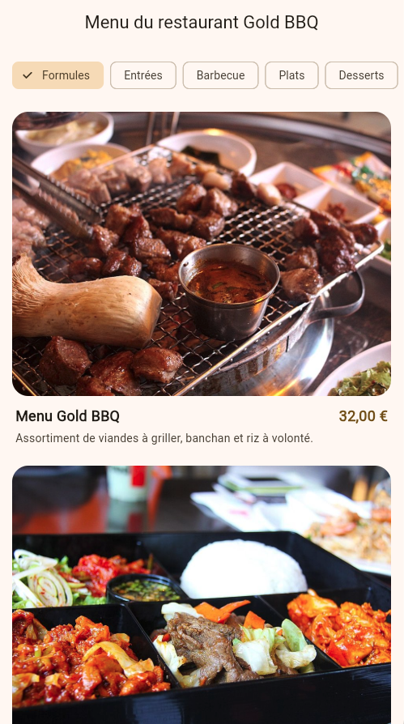

# Gold BBQ — Menu du restaurant

Application Flutter qui affiche le menu d'un restaurant de barbecue coréen.

## Fonctionnalités

- Catégories défilables horizontalement (Row dans un SingleChildScrollView)
- Liste verticale des plats de la catégorie choisie (ListView.builder)
- Carte de plat réutilisable : photo, nom, prix, description
- Portrait : 1 colonne. Paysage : 2 colonnes

## Organisation du code

- `lib/main.dart` : thème et lancement de l'app
- `lib/models/dish.dart` : ce qu'est un plat, et l'enum des catégories
- `lib/data/menu_data.dart` : la liste des plats
- `lib/screens/menu_screen.dart` : l'écran et la sélection de catégorie
- `lib/widgets/` : barre de catégories, liste et carte de plat

## Lancer le projet

    flutter pub get
    flutter run